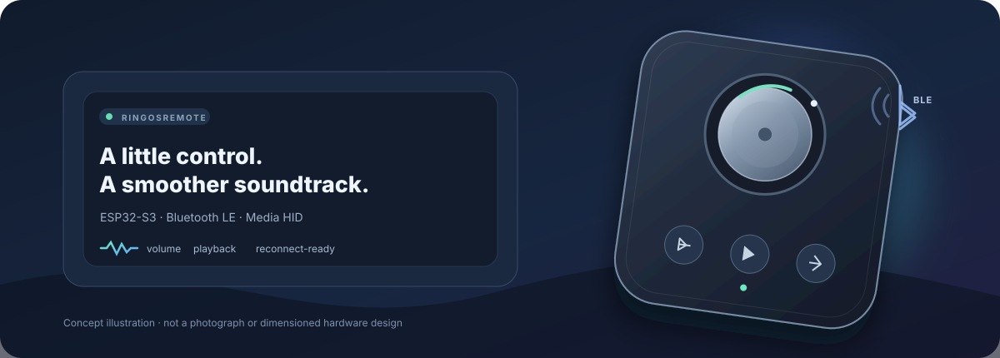
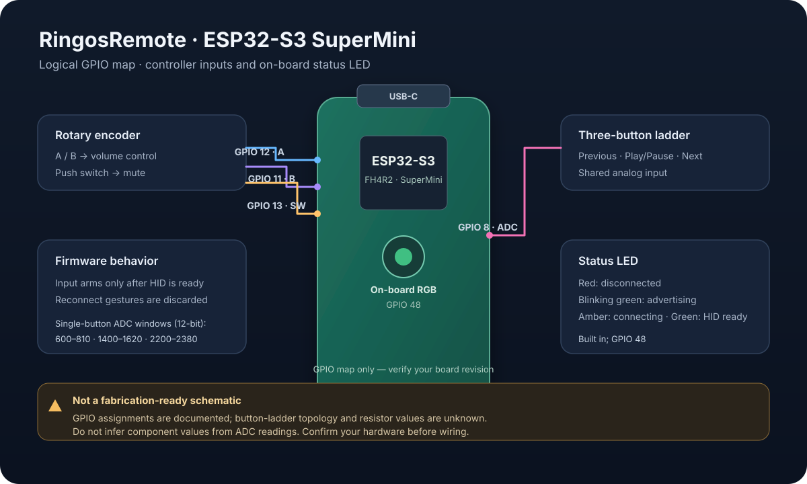
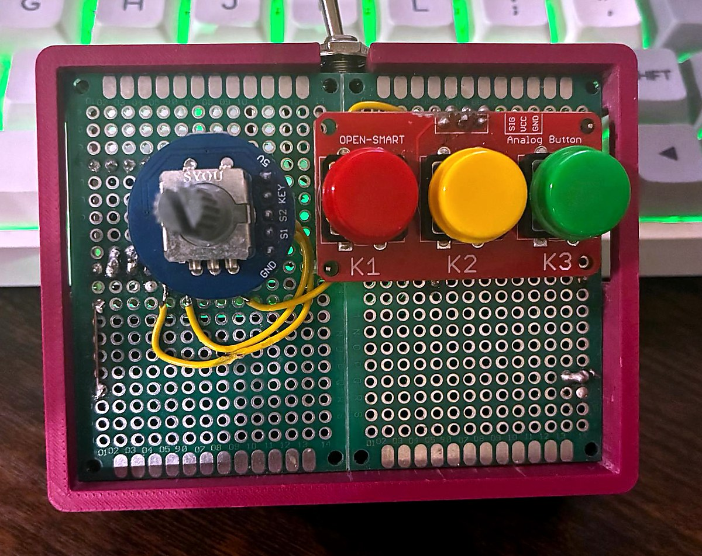
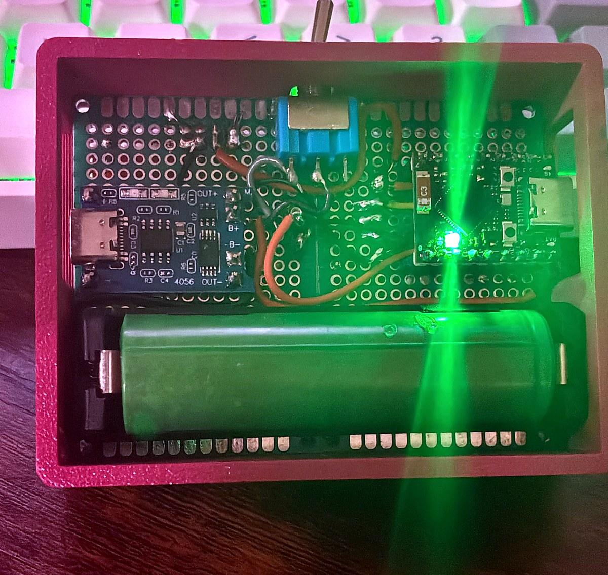

# ESP32 BLE Media Controller



**RingosRemote** is a Bluetooth LE media remote for macOS, built for an
ESP32-S3 SuperMini. Turn the rotary encoder to change volume, press it to mute,
or use the three-button analog ladder for previous, play/pause, and next.

The firmware uses BLE HID through NimBLE, waits for a stable HID session before
accepting input, and can enter light sleep after a configurable idle period.



> This is a firmware-oriented pin map, not a component-level circuit schematic.
> The resistor values and exact topology of the analog button ladder are not
> available in the project notes; see [Wiring](docs/wiring.md) before building
> the hardware.

## Features

- BLE media controls: volume up/down, mute, previous, play/pause, and next.
- HID input is enabled only after the BLE connection and input state stabilize.
- Gestures made while reconnecting are ignored rather than replayed later.
- Optional three-minute default inactivity timeout with ESP32-S3 light sleep.
- Hold the first and third analog buttons together for 12 seconds to reset
  Bluetooth pairing.
- USB serial commands for status, pairing reset, calibration, and restart.
- Host-side tests for HID readiness, idle timing, and the pairing hold gesture.

## Hardware

| Control | ESP32-S3 SuperMini GPIO | Firmware behavior |
| --- | ---: | --- |
| Rotary encoder A / B | 12 / 11 | Volume down / up |
| Encoder push switch | 13 | Mute |
| Analog button ladder | 8 (ADC) | Previous / play-pause / next |
| Built-in RGB LED | 48 | BLE state indicator |

The board target is `esp32-s3-devkitc-1`, configured for the SuperMini
ESP32-S3FH4R2 (4 MB flash and 2 MB quad-SPI PSRAM). See the
[wiring notes](docs/wiring.md) and the [pin map](docs/pin-map.svg).

### Prototype photos

<p align="center">
  
  
</p>

These are photos of the assembled prototype. They have been cropped and
lightly corrected for contrast and color; they are not circuit diagrams.

The three single-button ADC windows in the current firmware are 600–810,
1400–1620, and 2200–2380. The measured first+third combination uses
2410–2502. These are board-specific calibration readings, not universal
component specifications. The pairing combination can be recalibrated through
USB serial.

## Build and upload

Install [PlatformIO Core](https://docs.platformio.org/en/latest/core/installation/index.html),
connect the board over USB, and run these commands from the project root:

```sh
pio run
pio run -t upload
pio device monitor -b 115200
```

The first build downloads the configured Espressif platform and libraries. The
project pins NimBLE-Arduino to 2.5.1 and uses the local modified library in
`ESP32-BLE-Keyboard-master/`.

If the board stays in download mode, hold **BOOT**, press and release **RESET**,
then release **BOOT**. You can also reconnect USB while holding **BOOT**.

## Pairing and controls

The device advertises as **RingosRemote_2**. Pair it from the Mac's Bluetooth
settings. After a pairing reset, remove/forget the old device on the Mac before
pairing again.

| Action | Result |
| --- | --- |
| Rotate encoder | Volume down / up |
| Press encoder | Mute |
| Analog button 1 / 2 / 3 | Previous / play-pause / next |
| Hold buttons 1 + 3 for 12 seconds | Clear ESP32 Bluetooth bonds and restart |

The pairing gesture must be held continuously. Releasing early cancels it. The
first gesture after boot or calibration must be released before it can trigger
a reset.

### USB serial commands

Open the serial monitor at **115200 baud**, type a command, and press Enter:

| Command | Effect |
| --- | --- |
| `help` | List available commands |
| `status` | Print BLE/HID, input, bond, ADC, and sleep status |
| `pair` | Clear ESP32 bonds and restart |
| `calibrate-pair` | Sample buttons 1 + 3 held together for two seconds |
| `restart` | Restart while retaining existing bonds |

Calibration is stored in NVS and rejected if it is unstable or overlaps a
single-button range.

## Sleep and status LED

The default idle timeout is **3 minutes**. Change
`AUTO_SLEEP_TIMEOUT_MS` in [`include/ProjectConfig.h`](include/ProjectConfig.h):

```cpp
#define AUTO_SLEEP_TIMEOUT_MS 180000  // 3 minutes
```

Use `0` to disable automatic sleep. The firmware uses light sleep, not deep
sleep. Encoder pins can wake the chip directly; the analog button ladder is
sampled every 50 ms during sleep. The wake gesture restarts the firmware and
is not sent as a media command. Pairing and calibration remain in NVS.

The built-in RGB LED on GPIO 48 indicates BLE state:

| LED | State |
| --- | --- |
| Red | Disconnected |
| Blinking green | Advertising / discoverable |
| Amber | BLE link active, HID not ready |
| Green | HID connected |

The firmware turns off the RGB LED during sleep. A separate power LED on the
board or USB adapter may remain on. Battery life has not been measured; measure
the actual board current before estimating runtime.

## Reconnect behavior

The BLE transport can connect before encryption and HID subscriptions are
ready. The firmware waits for HID readiness and then requires released buttons
and a stationary encoder before arming input. Inputs during reconnection are
discarded to avoid delayed media actions.

In one reported series, all 10 software restarts reached a stable HID state;
first complete HID confirmation took 4.61–12.89 seconds. These observations
are not a guarantee of cold-boot reliability or a measurement of only the BLE
handshake. A redacted summary is available in
[`docs/reconnect-test.md`](docs/reconnect-test.md). Raw logs and device
identifiers are intentionally not published.

## Repository layout

```text
include/                  Shared interfaces and firmware configuration
src/                      Firmware modules
tests/                    Host-side C++ tests for small state helpers
docs/                     Wiring notes, diagrams, and test summary
ESP32-BLE-Keyboard-master/ Local BLE keyboard library used by PlatformIO
```

The [architecture diagram](docs/architecture.svg) shows the input, firmware,
and BLE HID flow.

## Tests

Run the host-side state tests with:

```sh
sh tests/run-host-tests.sh
```

They cover HID readiness transitions, idle timeout behavior, and the
12-second pairing hold timer. They do not emulate Bluetooth hardware.

## Third-party library

`ESP32-BLE-Keyboard-master/` is a locally modified ESP32 BLE Keyboard library
based on [T-vK/ESP32-BLE-Keyboard](https://github.com/T-vK/ESP32-BLE-Keyboard).
It contains project-specific NimBLE connection/readiness and report-handling
changes. NimBLE-Arduino and the rotary encoder and button libraries are
resolved by PlatformIO as listed in [`platformio.ini`](platformio.ini).

## Contributions

Hardware revisions, measured wiring details, and reproducible test reports are
welcome. Do not include Bluetooth addresses or other personal device
identifiers in logs or issue reports.
